# LineUP

**Афиша, лайнап и контроль входа для клубов и мероприятий.**

LineUP — лёгкий сайт и админка для ночных клубов: расписание по залам с
подсветкой текущего сета, гостевые списки с QR-приглашениями, саморегистрация,
режим охраны со сканером и оффлайн-копией, статистика входа и оформление под
бренд. Python, SQLite и обычный JavaScript — без тяжёлых фреймворков.

[](https://www.python.org/)
[](https://sqlite.org/)
[](https://developer.mozilla.org/docs/Web/JavaScript)

<p align="center">
  <a href="docs/screenshots/showcase.webp">
    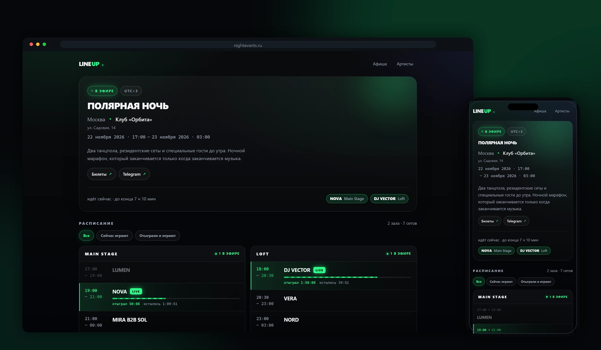
  </a>
</p>

<p align="center"><sub>Публичная афиша на компьютере и в телефоне. Демо-данные.</sub></p>

[Возможности](#возможности) · [Скриншоты](#скриншоты) · [Быстрый старт](#быстрый-старт) · [Админка](#как-пользоваться-админкой) · [API](#api-кратко) · [Безопасность](#безопасность) · [Деплой](#деплой-на-nginx-ubuntudebian-один-сервер)

## Возможности

- **Публичная часть** — адаптивная афиша: название, город и место, дата и время
  начала/конца (в том числе через полночь), залы и сеты. Текущий исполнитель
  подсвечивается зелёным, под ним идёт полоса прогресса и тикает
  «отыграл 00:42:15».
- **Фильтр расписания** — над залами есть кнопки «Все», «Сейчас играют» и
  «Отыграли и играют». Фильтр сам обновляется по ходу вечера: можно оставить на
  экране только текущие сеты или всех, кто уже отыграл и играет сейчас.
  Организатор может жёстко зафиксировать один из режимов в админке — тогда кнопки
  скрыты, и зритель видит только выбранные сеты.
- **Админка** (`/admin`) — вход по логину и паролю, создание и удаление
  мероприятий, залов и выступлений. У каждого сета обязательны начало и конец;
  пересечения внутри зала и выход за рамки мероприятия отклоняются.
- **Ссылка и QR мероприятия** — в карточке и редакторе есть кнопки
  «Скопировать ссылку» и «Скачать QR». QR в PNG генерируется на лету и не
  хранится на диске; после удаления или окончания мероприятия он больше не
  отдаётся.
- **Гостевые списки** — внутри мероприятия можно создать несколько списков,
  назначить на один список нескольких промоутеров или сразу добавить промоутера
  во все списки. У каждого гостя есть персональная ссылка и QR для входа:
  организатор отправляет её через системное «Поделиться» на телефоне, а гость
  показывает QR на входе. Имя, телефон и заметки гостя можно отредактировать,
  а самого гостя — переместить в другой список. Публичная страница приглашения
  не раскрывает телефон и заметки; после окончания или удаления мероприятия
  ссылка перестаёт работать. Дополнительных гостей и особые пожелания можно
  указать в комментарии к гостю. Гостей можно добавлять и в неопубликованное
  мероприятие: оно не показывается в афише, но прямые ссылки и QR работают.
- **Чёрный список** — создаётся автоматически у каждого мероприятия. Гости из
  него не получают рабочие приглашения и не учитываются в статистике прихода.
  В режиме проверки такой гость подсвечивается красным предупреждением
  «Гость в чёрном списке — не пускать», а сканирование его QR или гостя с
  совпадающим телефоном/именем не отмечает приход. Чёрный список нельзя удалить
  или переименовать, и он не назначается промоутерам.
- **Саморегистрация гостей** — организатор или главный администратор создаёт
  публичные ссылки `/r/<token>` на выбранный гостевой список. У каждой ссылки
  есть комментарий для администратора, лимит регистраций и срок действия:
  бессрочно, в момент начала, через 1–3 часа после начала или своя дата и время.
  После лимита или окончания срока регистрация закрывается. Гость заполняет имя
  и телефон, сразу получает персональное приглашение с QR и попадает в список.
  Ссылку можно закрыть, открыть снова или удалить; зарегистрированные гости при
  удалении остаются в списке. Комментарии ссылок и количество регистраций видны
  только администраторам.
- **Режим проверки для охраны и персонала** — организатор создаёт отдельную
  ссылку `/door/<token>`, открывает её на телефоне или планшете и передаёт
  охране, барменам или персоналу VIP-зоны. В этом режиме можно искать гостя по
  имени/телефону, сканировать QR камерой или USB-сканером, отмечать приход и
  отменять ошибочную отметку. Список гостей сохраняется на устройстве: если
  интернет пропадёт, поиск, QR-коды и отметки продолжат работать, а действия
  отправятся на сервер автоматически, когда связь вернётся. Внизу страницы есть
  короткая справка об оффлайн-режиме и напоминание не закрывать вкладку до конца
  смены. В результатах видно, из какого списка гость
  (например, VIP), и только последние 4 цифры телефона. Если браузер не умеет
  `BarcodeDetector` (например, Chrome на Windows), автоматически подключается
  встроенный JS-декодер. Для камеры и оффлайн-копии обязателен HTTPS; на
  телефоне обычная HTTP-ссылка не даст доступ. Камера разрешена только на
  странице `/door/<token>`
  через `Permissions-Policy`; на остальных страницах она запрещена. Ссылку
  можно обновить или отозвать. Ссылку можно создать и для неопубликованного
  мероприятия: публичная афиша останется скрытой, но режим персонала уже
  работает по секретной ссылке.
- **Обмен артистов и замена** — галочки рядом с именами выбирают два сета: кнопка
  «Поменять» сразу меняет артистов местами, не трогая забронированное время.
  Кнопка «Замена» отмечает слот, где артист не приехал. После этого в поле имени
  можно указать, кто отыграет сет: имя появится на сайте с пометкой «замена».
  Если оставить поле пустым, на сайте будет просто «Замена» — замена ещё не
  найдена. Исходный артист сохраняется и возвращается кнопкой «Вернуть».
- **Перенос мероприятия** — кнопка «Перенести время» в редакторе меняет начало
  события, не пересобирая расписание: все сеты сдвигаются на тот же интервал,
  порядок и длительность сохраняются, конец пересчитывается автоматически.
- **Роли и промоутеры** — главный администратор (`super`) видит все мероприятия,
  управляет администраторами и журналом действий. Обычный администратор видит и
  меняет только свои мероприятия, но может создавать промоутеров и удалять
  только тех, кого добавил сам. У промоутера можно указать срок действия или
  сделать учётную запись бессрочной; когда срок истекает, учётная запись
  удаляется автоматически. Лайнап можно опубликовать позже: как анонс без
  залов и артистов или с автопубликацией.
- **Архив мероприятий** — через 7 дней после окончания событие исчезает с
  публичного сайта, но остаётся в админке. Если перенести его время в будущее,
  оно снова публикуется автоматически; ненужное можно удалить.
- **Артисты и диджеи** — отдельная страница `/artists` с поиском. Показываются
  только артисты, у которых есть ещё не закончившийся сет в предстоящем или
  идущем мероприятии, и места, где они играют. Прошедшие мероприятия и
  отыгравшие сеты в список не попадают; артиста без актуального сета нельзя
  найти по имени. Исполнители из скрытого лайнапа не раскрываются. Если жёсткий
  фильтр расписания скрывает время сета, артист и мероприятие всё равно
  показываются, а вместо времени выводится пометка «Точное время выступления не
  показано». Совместные сеты делятся на отдельных артистов по маркерам
  `(VS)`, `(B2B)`, `(F2F)`, `(&)` и `(AND)` в любом регистре: «ZVUK (B2B) RAZNOS»
  даёт карточки ZVUK и RAZNOS. В расписании эти маркеры показываются без скобок:
  «NOVA (b2b) ZVUK» выглядит как «NOVA B2B ZVUK», «SOL (&) VERA» — как
  «SOL & VERA». Список обновляется автоматически.
- **База исполнителей** — имена, добавленные в сеты, запоминаются и предлагаются
  в автозаполнении. У обычного администратора — только свои артисты, у главного —
  все. Главный может удалять лишние имена: они перестают предлагаться и
  находиться в публичном поиске артистов.
- **Оформление сайта** — главный администратор может загрузить PNG-логотип вместо
  надписи LineUP, изменить копирайт в подвале, выбрать одну из 11 готовых тем
  (по умолчанию — «Изумруд») или собрать свою: фон, панели, текст, акцент и
  полоса тайминга настраиваются отдельно. В подвал можно добавить кнопки с
  описаниями: «О проекте», «Контакты» и т. п. Открытые страницы подхватывают
  изменения при возврате на вкладку или в течение минуты.
- **Без зависимостей от фреймворков**: Python 3.11+, WSGI, SQLite, обычный
  JavaScript. В продакшене — gunicorn за nginx.

| Кому | Что даёт LineUP |
| --- | --- |
| **Организатору** | Афиша и расписание, переносы без пересборки, роли, оформление, журнал действий и статистика входа. |
| **Промоутеру** | Свои гостевые списки и ссылки, добавление гостей, отметки прихода и видимость только своих мероприятий. |
| **Охране и персоналу** | Поиск по имени и последним 4 цифрам, QR-сканер, чёрный список и оффлайн-режим на входе. |
| **Гостю** | Персональное приглашение с QR, саморегистрация и понятная страница мероприятия без установки приложения. |

> **Камеры и QR-сканирование.** Сканирование QR работает на Windows, Android
> и iPhone, но камера в браузере доступна только по **HTTPS**. Исключение —
> `localhost` на самом компьютере. Если открыть ссылку персонала по обычному
> `http://192.168…`, телефон не покажет запрос доступа к камере. На Windows
> Chrome используется `BarcodeDetector`, при его отсутствии — встроенный jsQR;
> на iPhone Safari — jsQR. Встроенные браузеры Telegram, WhatsApp и Instagram
> могут блокировать камеру: открывайте ссылку в Chrome или Safari. Если камера
> недоступна, остаются поиск по имени/телефону, ручной ввод кода для
> USB-сканера и оффлайн-копия списка.

> **Нагрузка:** на 2 ядрах / 2 ГБ RAM — **10–15 тыс. одновременно открытых
> страниц** с запасом. Подробные замеры — в разделе
> [«Производительность»](#производительность).

## Производительность

Синтетический тест на тестовом стенде **2 ядра / 2 ГБ RAM**: Ubuntu, nginx,
gunicorn (3 воркера), SQLite, демо-база, локальная сеть, HTTP.

| Сценарий | Запросов/с | p95 | CPU gunicorn |
| --- | ---: | ---: | ---: |
| API главной `/api/public/featured` | 1 150–1 250 | 12–193 мс | 82–83% |
| API артистов `/api/public/artists` | 1 200–1 330 | 12–100 мс | 80–82% |
| Страница мероприятия | ~2 400 | 47 мс | 67% |
| Статика через nginx | 2 800–6 000 | 20–100 мс | 0% |

Приложение занимает около **58 МБ RAM**. Главная опрашивает API раз в 30 секунд,
а статику отдаёт nginx. Поэтому 5 000 открытых главных — это примерно **12% CPU**,
10 000 — **24%**, 20 000 — **48%**. p95 — время, быстрее которого отвечают 95%
запросов.

**Рекомендация:** для реального мероприятия с переходами, TLS и админкой
закладывать **10–15 тыс. одновременно открытых страниц**. Теоретический предел
по CPU — около **25–30 тыс.**; при устойчивой нагрузке выше 70% CPU лучше
перейти на 4 ядра. Цифры ориентировочные: зависят от размера базы и профиля
трафика.

Демо-данные можно включить командой `python manage.py seed-demo`: появятся два
мероприятия, одно из них идёт «прямо сейчас», чтобы сразу увидеть живое
выделение.

## Скриншоты

Все изображения — с локального демо-стенда. Названия клубов, артистов и гостей
вымышлены.

### Публичный сайт

| Афиша | Мероприятие |
| --- | --- |
| [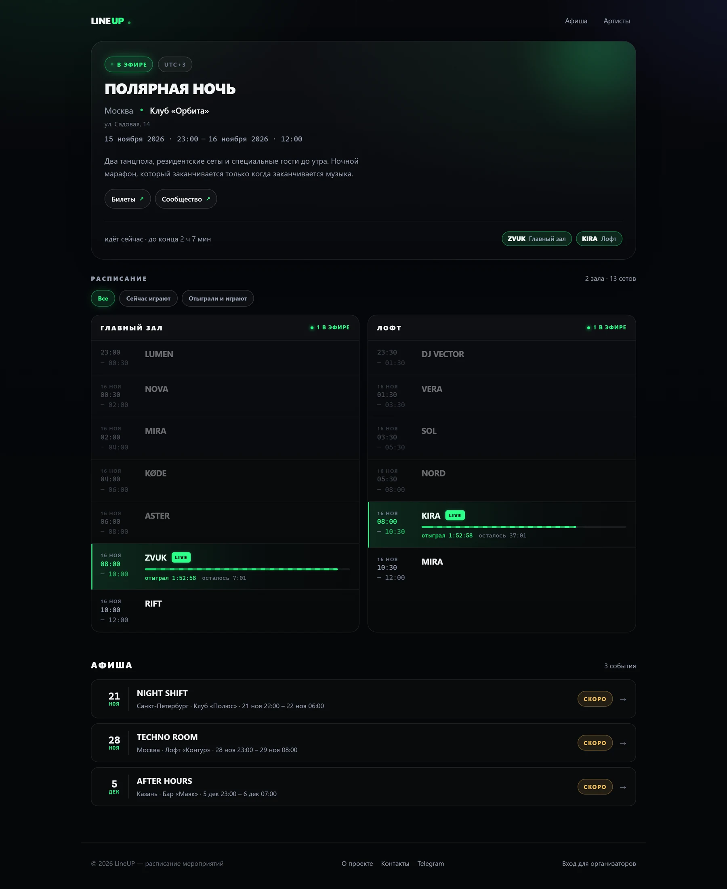](docs/screenshots/home.webp) | [](docs/screenshots/event-live.webp) |
| <sub>Событие в эфире, залы, прогресс сета и ближайшая афиша.</sub> | <sub>Текущий сет, оставшееся время и расписание по залам.</sub> |

| Предстоящее событие | Артисты и диджеи |
| --- | --- |
| [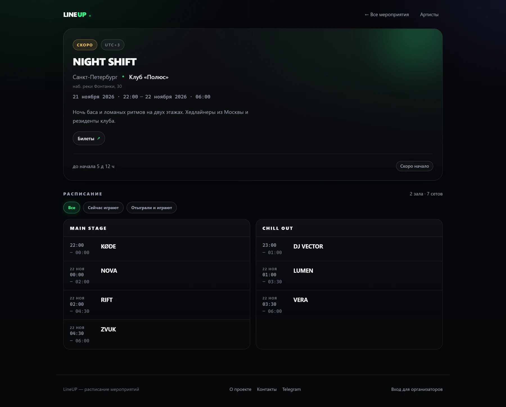](docs/screenshots/event-upcoming.webp) | [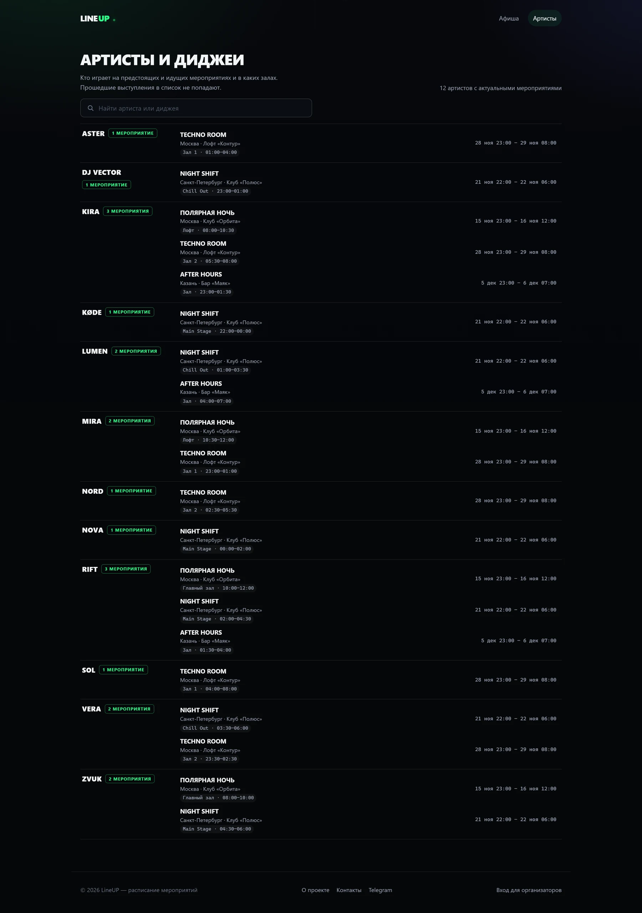](docs/screenshots/artists.webp) |
| <sub>Обратный отсчёт до начала и лайнап без подсветки.</sub> | <sub>Поиск артиста, его мероприятия и залы.</sub> |

### Телефон

| Афиша | Расписание | Приглашение |
| --- | --- | --- |
| [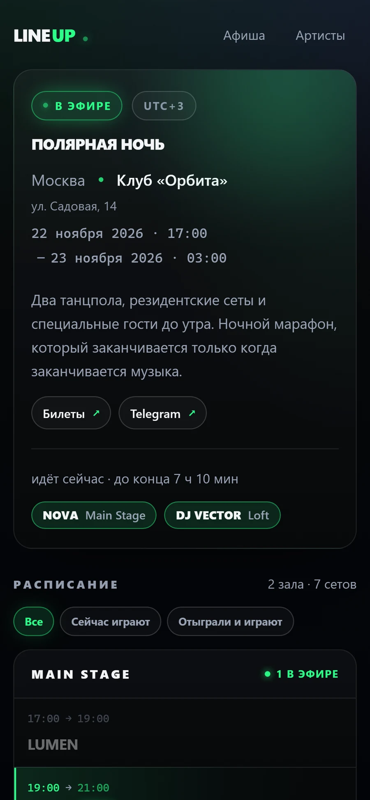](docs/screenshots/mobile-home.webp) | [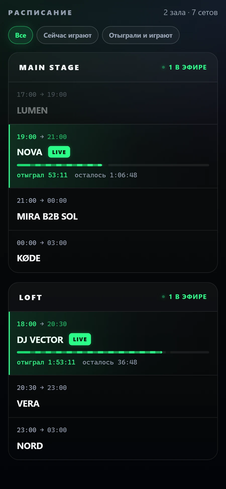](docs/screenshots/mobile-event.webp) | [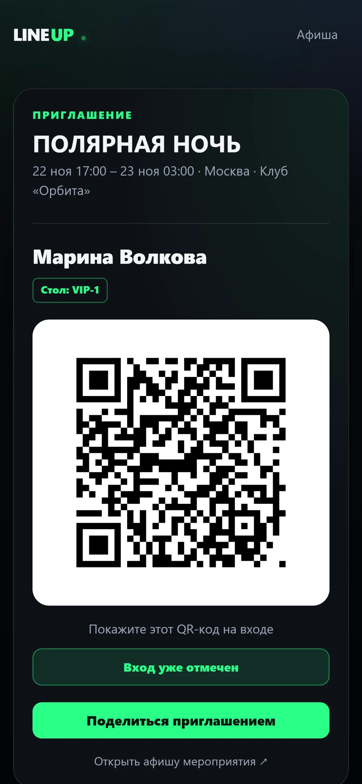](docs/screenshots/mobile-guest.webp) |
| <sub>Афиша и текущий сет.</sub> | <sub>Подсветка сета, который играет сейчас.</sub> | <sub>Имя, стол и QR для входа.</sub> |

| Саморегистрация | Режим охраны | Оффлайн-вход |
| --- | --- | --- |
| [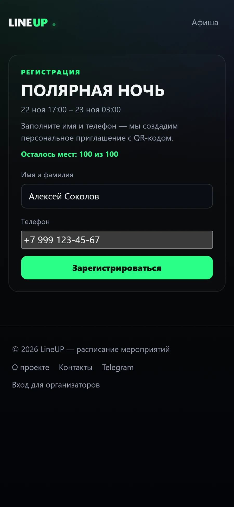](docs/screenshots/mobile-registration.webp) | [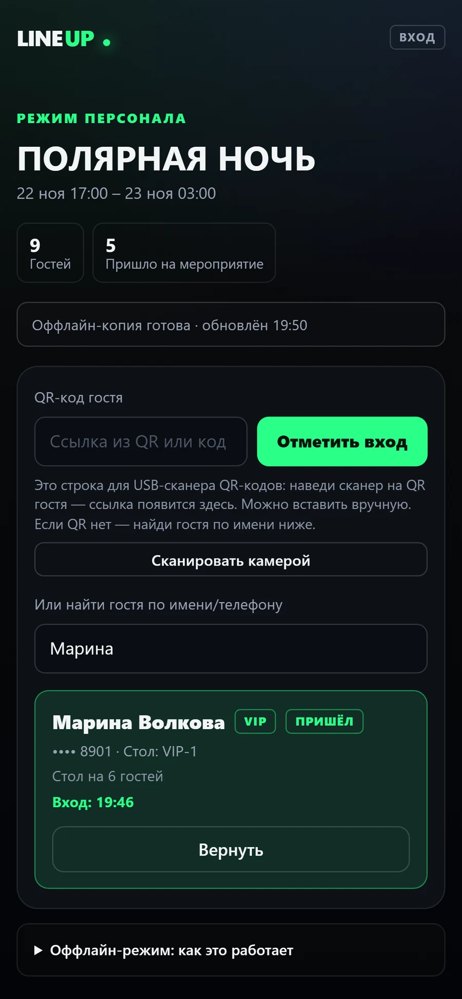](docs/screenshots/mobile-door.webp) | [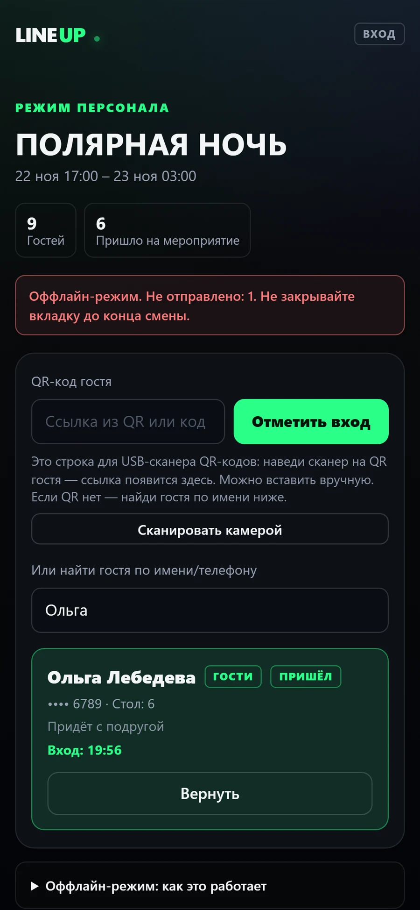](docs/screenshots/mobile-door-offline.webp) |
| <sub>Имя и телефон, лимит мест, сразу персональный QR.</sub> | <sub>Поиск гостя, VIP-стол и статус оффлайн-копии.</sub> | <sub>Отметка без связи: действие ждёт отправки.</sub> |

### Админка

<p align="center">
  <a href="docs/screenshots/admin-events.webp">
    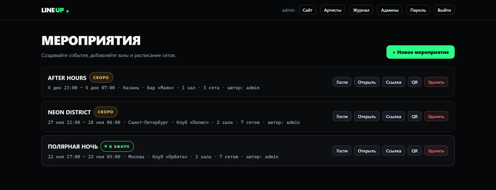
  </a><br>
  <sub>Список мероприятий: статусы «в эфире» и «скоро», залы, сеты и быстрые действия.</sub>
</p>

| Редактор и расписание | Гости, промоутеры и ссылки |
| --- | --- |
| [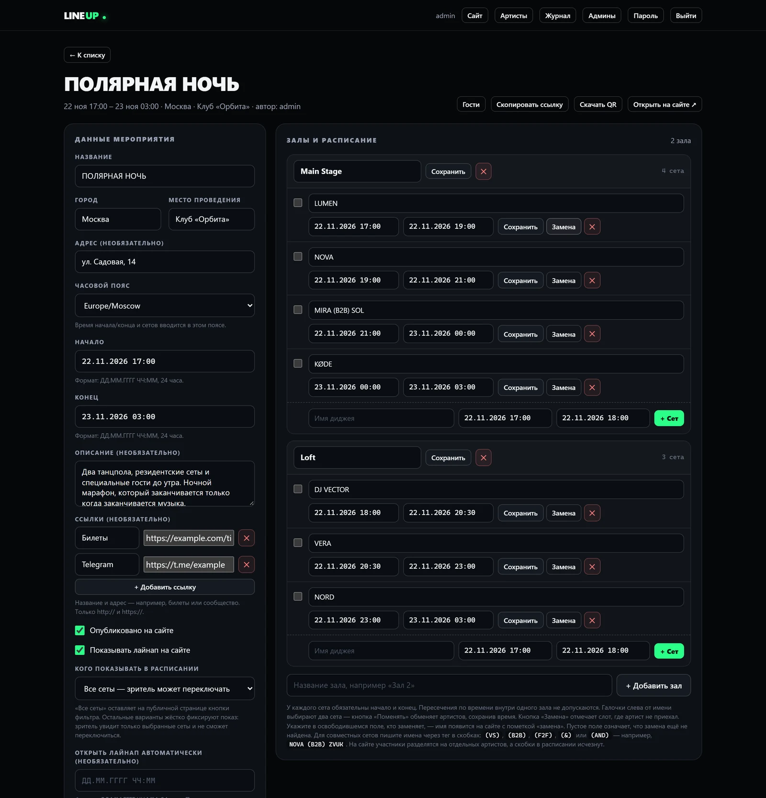](docs/screenshots/admin-event.webp) | [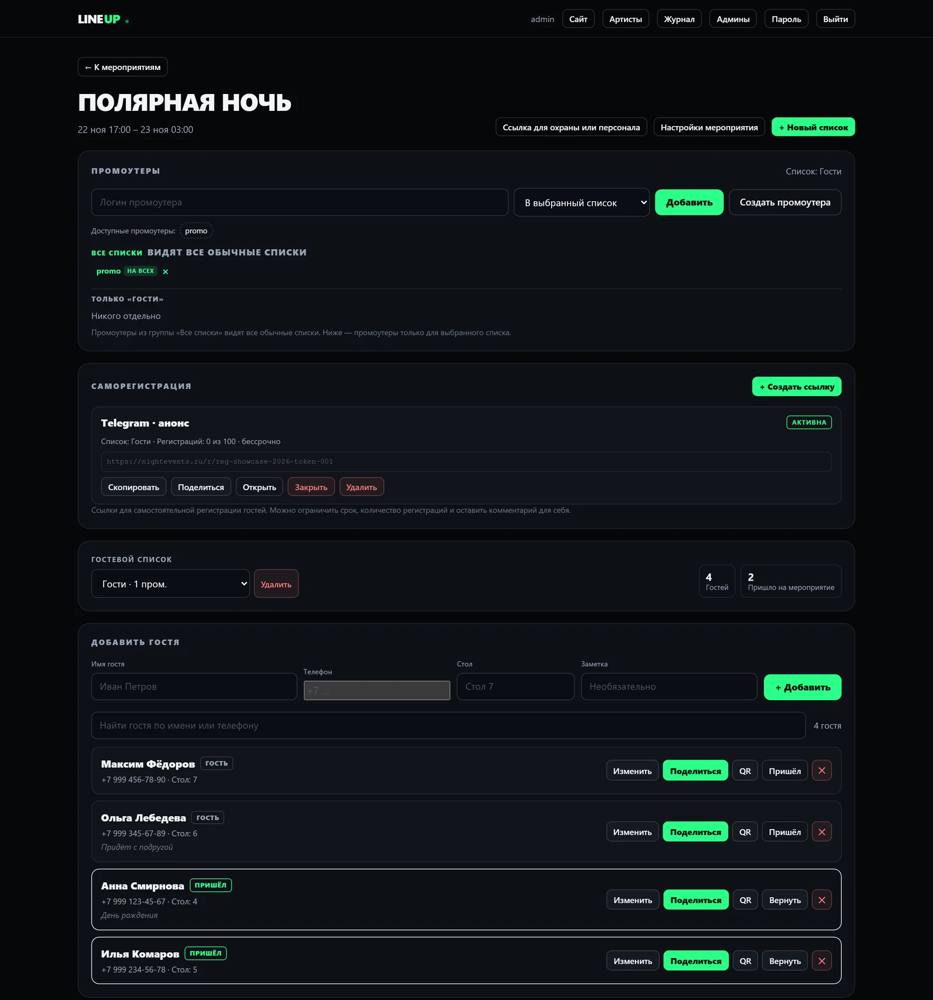](docs/screenshots/admin-guests.webp) |
| <sub>Данные, ссылки, публикация лайнапа и расписание по залам.</sub> | <sub>Списки, промоутеры, саморегистрация, добавление гостей, QR и отметки входа.</sub> |

<p align="center">
  <a href="docs/screenshots/admin-promoters.webp">
    
  </a><br>
  <sub>Промоутеры: доступ к выбранному списку или сразу ко всем обычным спискам.</sub>
</p>

Больше изображений и подписи к ним — в [docs/screenshots](docs/screenshots/README.md).

---

## Быстрый старт

Нужен Python 3.11+ (проверено на 3.15).

```bash
python -m venv .venv
# Linux/macOS:
source .venv/bin/activate
# Windows (PowerShell):
# .venv\Scripts\Activate.ps1

pip install -r requirements.txt

python manage.py initdb
python manage.py createadmin          # спросит логин и пароль (мин. 10 символов)
python manage.py seed-demo            # необязательно: демо-афиша
python manage.py serve --port 8080
```

Первый созданный администратор автоматически становится **главным**
(`super`): он может добавлять других администраторов, удалять их и менять им
пароль. Обычные администраторы могут создавать только промоутеров — с датой
окончания срока действия или бессрочных — и управлять только ими.

Откройте:

- сайт — <http://127.0.0.1:8080/>
- админка — <http://127.0.0.1:8080/admin>

`manage.py serve` — только для разработки (встроенный сервер Python). На
сервере используется gunicorn, см. раздел «Деплой на nginx».

Полезные команды:

```bash
python manage.py list                 # список мероприятий
python manage.py createadmin --username admin
python manage.py createadmin --username second --super   # сделать главным
python manage.py passwd --username admin
python manage.py seed-demo
python manage.py initdb
```

Пароль можно передать неинтерактивно через `LINEUP_ADMIN_PASSWORD` (удобно для
автоматизации), но не храните его в истории shell на боевом сервере.

---

## Как пользоваться админкой

1. Войдите на `/admin`.
2. **«+ Новое мероприятие»** — заполните название, город, место, адрес,
   часовой пояс, начало и конец. Конец может быть на следующий день.
   Снимите галочку «Опубликовано», чтобы подготовить событие скрытно.
   Дата и время вводятся в формате **ДД.ММ.ГГГГ ЧЧ:ММ** (24 часа), например
   `05.11.2027 20:00`.
3. Сохраните. После этого станут доступны залы.
4. **«+ Добавить зал»** — например, «Зал 1». Залов может быть сколько угодно.
5. В карточке зала заполните строку **«Имя диджея»**, начало и конец сета и
   нажмите **«+ Сет»**. Для совместного сета пишите имена через тег:
   `NOVA (B2B) ZVUK`, `SOL (&) VERA`, `RIFT (AND) NOVA`. Поддерживаются
   `(VS)`, `(B2B)`, `(F2F)`, `(&)` и `(AND)` в любом регистре — на сайте
   участники разделятся на отдельных артистов, а скобки исчезнут.
6. Время подставляется автоматически: начало = конец предыдущего сета, конец =
   +1 час. Значения можно менять.
7. Кнопка **«Открыть на сайте ↗»** ведёт на публичную страницу. Рядом —
   **«Скопировать ссылку»** и **«Скачать QR»**: QR в PNG генерируется на лету и
   подходит для печати. После окончания или удаления мероприятия QR больше не
   отдаётся.
8. В блоке **«Ссылки»** можно добавить до 12 ссылок (название + адрес
   `http://` или `https://`): билеты, сообщество, плейлист. На публичной
   странице они показываются кнопками под описанием.
9. Кнопка **«Админы»** в шапке (у главного) открывает управление
   администраторами и промоутерами. Обычный администратор видит там раздел
   **«Промоутеры»** и управляет только созданными им учётными записями. Пароль
   можно сменить, лишнего промоутера — удалить. Главного администратора удалить
   или сменить ему пароль из этого раздела нельзя — свой пароль он меняет
   кнопкой **«Пароль»**. У промоутера можно указать срок действия; пустое поле
   означает бессрочную учётную запись.
10. Блок **«Показывать лайнап на сайте»** и поле **«Открыть лайнап
    автоматически»** управляют видимостью расписания. Если снять галочку,
    зрители видят анонс с описанием и ссылками, но без залов и артистов. Если
    оставить галочку и указать дату, до этого момента лайнап скрыт, а затем
    открывается сам.
11. Поле **«Кого показывать в расписании»** задаёт жёсткий фильтр публичной
    страницы: все сеты, только те, кто играет сейчас, или отыгравшие и играющие
    сейчас. В двух последних режимах кнопки фильтра у зрителей скрыты — обойти
    выбранный показ нельзя.
12. Кнопка **«Журнал»** (только у главного) показывает, кто создавал, менял и
    удалял мероприятия, залы, артистов и администраторов. Кнопка
    **«Очистить журнал»** удаляет все записи без создания новой.
13. При вводе имени исполнителя автозаполнение подсказывает имена из базы.
    Имя сохраняется даже после удаления сета — оно останется в подсказках.
    Кнопка **«Артисты»** (только у главного) открывает список имён: по нему можно
    искать, а лишние — удалять; удалённые перестанут предлагаться и находиться в
    публичном поиске.
14. Если мероприятие закончилось больше 7 дней назад, в списке появится метка
    **«скрыто»**, а ссылка «Открыть на сайте» будет недоступна. Измените начало
    и конец на будущее время и сохраните — событие опубликуется снова.
15. Кнопка **«Перенести время»** рядом с «Сохранить» спрашивает новое начало
    мероприятия и сдвигает на тот же интервал все залы и сеты: их порядок и
    длительность не меняются, конец события пересчитывается. Удобно, если дата
    была указана с ошибкой, а расписание уже составлено. Время открытия лайнапа
    также сдвигается на тот же срок.
16. Кнопка **«Сайт»** (только у главного) открывает оформление публичных страниц:
    загрузку PNG-логотипа вместо надписи LineUP, редактор копирайта, выбор темы
    и редактор кнопок в подвале. Доступны 11 готовых тем и своя тема с цветами
    фона, панелей, текста, акцента и полосы тайминга. У кнопки подвала есть
    название, описание и необязательная ссылка; по клику на сайте открывается
    диалог с описанием. Если убрать логотип, надпись LineUP возвращается.
    Открытые публичные страницы обновляют оформление сами: при возврате на
    вкладку или в течение минуты.
17. Кнопка **«Гости»** открывает гостевой список мероприятия. Сверху есть блок
    **«Промоутеры»**: промоутеры, назначенные на все обычные списки, вынесены
    в отдельную выделенную группу **«Все списки»**, а ниже показаны промоутеры
    только для выбранного списка. В поле логина работает автозаполнение и
    видны промоутеры, созданные администратором мероприятия. Если аккаунта
    ещё нет, его можно создать прямо оттуда. У гостя есть кнопки
    **«Поделиться»** (системное меню телефона: Telegram, WhatsApp и другие
    мессенджеры) и **«QR»**. Кнопка **«Изменить»** позволяет поменять имя,
    телефон, стол, заметку и переместить гостя в другой список. Кнопка
    **«Пришёл»** отмечает приход. Количество сопровождающих отдельно не
    указывается — его можно написать в комментарии к гостю.
    У каждого мероприятия автоматически есть **«Чёрный список»**. Его нельзя
    удалить или переименовать, гости оттуда не получают рабочие приглашения,
    а в режиме проверки показывается красное предупреждение и вход блокируется.
18. Кнопка **«Ссылка для охраны или персонала»** в гостевом разделе создаёт
    ссылку на режим проверки. Откройте её на телефоне/планшете охраны, бармена
    или персонала VIP-зоны: там есть поиск по имени и телефону, сканирование QR
    камерой и ручной ввод кода для USB-сканера. В карточке гостя видно название
    гостевого списка (например, VIP), а телефон показывается только последними
    4 цифрами. Страница сохраняет список на устройстве: если связь пропадёт,
    поиск, QR и отметки входа продолжат работать, а при возврате интернета
    действия отправятся автоматически. Внизу страницы есть справка об
    оффлайн-режиме. Гости из чёрного списка и совпадения по телефону/имени
    подсвечиваются красным, сканирование не отмечает им приход. Ссылку можно
    обновить (старая перестанет работать) или отозвать. Ссылка работает и для
    неопубликованного мероприятия — публичная афиша при этом остаётся скрытой.
19. Блок **«Саморегистрация»** под промоутерами создаёт публичные ссылки для
    гостей. Выберите список, оставьте комментарий (например, «для Telegram»),
    задайте лимит регистраций и срок действия. Ссылку можно скопировать,
    отправить через «Поделиться», открыть, закрыть или удалить. При удалении
    ссылки уже зарегистрированные гости остаются в списке. После лимита,
    истечения срока или окончания мероприятия регистрация закрывается сама.

Обмен артистов: поставьте галочки у двух сетов (в одном или разных залах одного
мероприятия) — над расписанием появится кнопка **«Поменять»**. Артисты поменяются
местами, а начало и конец каждого сета останутся прежними; изменения сохраняются
сразу. Если артист не приехал, нажмите **«Замена»** в его строке: поле имени
останется доступным, и вы сможете указать, кто заменяет. Пока имя пустое, на
сайте в этом слоте написано «Замена»; после сохранения имени оно показывается в
расписании с пометкой «замена» и попадает в список артистов. Кнопка **«Вернуть»**
возвращает исходного артиста.

Обычный администратор видит и может менять только созданные им мероприятия,
а также мероприятия, где ему назначен гостевой список. Чужие мероприятия для
него не существуют — API отвечает `404 not_found`, чтобы не раскрывать их
существование. Главный администратор видит все мероприятия и журнал действий.
Промоутер видит только мероприятия с назначенными ему списками и не может
создавать события или управлять пользователями. При удалении администратора
его мероприятия переходят действующему администратору.

Ограничения, которые проверяет сервер:

- конец мероприятия позже начала, длительность — не больше 14 дней;
- сет полностью лежит внутри времени мероприятия;
- в одном зале сеты не пересекаются (вернётся понятная ошибка с именем
  конфликтующего диджея);
- имя исполнителя, название зала и мероприятия обязательны.

Удаление мероприятия каскадно удаляет его залы и сеты.

Публичная видимость: `published = 1` и `ends_at >= now - 7 дней`. Черновики и
события, завершившиеся раньше, не отдаются публичным API и не открываются по
прямой ссылке `/e/<slug>`, но продолжают отображаться в админке. Срок можно
изменить переменной `LINEUP_PUBLIC_RETENTION_DAYS`.

Часовой пояс — IANA-имя (`Europe/Moscow`, `Asia/Yekaterinburg`, …). Вся
админка вводит и показывает время **в поясе мероприятия** в формате
`ДД.ММ.ГГГГ ЧЧ:ММ` (24 часа), а в базе хранится UTC, поэтому зритель в другом
часовом поясе увидит корректное время. API по-прежнему принимает и отдаёт
локальные строки `YYYY-MM-DDTHH:MM`.

---

## Как работает «сейчас играет»

- Все моменты времени хранятся в UTC.
- Публичная страница получает вместе с расписанием `serverNow` и поправляет
  расхождение часов устройства.
- Раз в секунду клиент пересчитывает состояние каждого сета:
  `прошёл` / `идёт` / `впереди`.
- Для идущего сета включается класс `.is-live`: зелёный фон и полоса слева,
  бейдж **LIVE**, полоса прогресса с бегущими штрихами и подписи
  «отыграл Ч:ММ:СС» и «осталось Ч:ММ:СС».
- Список в шапке и счётчики «N в эфире» в залах обновляются от тех же данных.
- Страница тихо перезапрашивает расписание раз в 30 секунд, поэтому изменения
  из админки появляются без перезагрузки.
- Если сейчас между сетами, показывается «Антракт», до начала — обратный
  отсчёт, после конца — «мероприятие прошло».

---

## Структура проекта

```
app.py                  WSGI-приложение, маршруты, API, защита
db.py                   SQLite: схема, подключение
security.py             scrypt-пароли, токены сессий
timeutil.py             пересчёт часовых поясов, валидация времени
manage.py               CLI: initdb, createadmin, passwd, seed-demo, serve
tests/test_app.py       интеграционные тесты (89 шт.)
requirements.txt
public/
  index.html            главная: текущее/ближайшее событие + афиша
  event.html            страница мероприятия /e/<slug>
  artists.html          публичный список артистов и диджеев /artists
  guest.html            мобильная страница приглашения /g/<token>
  registration.html     публичная саморегистрация /r/<token>
  door.html             режим проверки для охраны и персонала /door/<token>
  door-sw.js            service worker: оффлайн-кэш страницы и ресурсов входа
  admin.html            админка
  assets/style.css      оформление
  assets/common.js      форматирование, расписание, «часы»
  assets/home.js        главная
  assets/event.js       страница события
  assets/artists.js     поиск и список артистов
  assets/guest.js       приглашение и QR гостя
  assets/registration.js  форма саморегистрации и личный QR
  assets/door.js        сканирование и отметка прихода персоналом
  assets/door-offline.js  IndexedDB: оффлайн-копия списка и очередь действий
  assets/jsQR.js        QR-декодер для браузеров без BarcodeDetector
  assets/jsQR.LICENSE.txt
  assets/admin.js       админка
docs/screenshots/       скриншоты для README
deploy/
  nginx.conf            пример конфигурации nginx
  lineup.service        unit systemd для gunicorn
  lineup.env.example    переменные окружения
data/                   SQLite-база (создаётся автоматически, в git не входит)
```

---

## Настройки окружения

| Переменная | По умолчанию | Назначение |
|---|---|---|
| `LINEUP_DB` | `data/lineup.db` | путь к SQLite-базе |
| `LINEUP_TRUST_PROXY` | `1` | доверять `X-Forwarded-*` от nginx |
| `LINEUP_COOKIE_SECURE` | `auto` | `1` — ставить cookie только по HTTPS; `auto` — по схеме запроса |
| `LINEUP_SESSION_HOURS` | `12` | срок жизни сессии админки |
| `LINEUP_LOGIN_MAX_FAILURES` | `10` | неудачных входов с одного IP до блокировки |
| `LINEUP_LOGIN_MAX_USER_FAILURES` | `20` | неудачных входов на один логин |
| `LINEUP_LOGIN_WINDOW` | `900` | окно блокировки, секунд |
| `LINEUP_ASSET_CACHE` | `public, max-age=86400` | `Cache-Control` для статики, когда её отдаёт приложение |
| `LINEUP_PUBLIC_RETENTION_DAYS` | `7` | сколько дней после окончания событие остаётся на сайте |
| `LINEUP_AUTO_INIT` | `1` | создавать схему БД при старте |
| `LINEUP_PUBLIC_DIR` | `./public` | каталог статики |

Секретов в окружении нет: пароли хранятся в виде scrypt-хешей, сессии — это
случайные токены, в базе лежат только их SHA-256.

---

## Деплой на nginx (Ubuntu/Debian, один сервер)

Ниже — вариант «nginx + gunicorn + SQLite». Всё уже подготовлено в `deploy/`.

### 1. Пользователь и каталоги

```bash
sudo useradd --system --home /var/lib/lineup --shell /usr/sbin/nologin lineup
sudo mkdir -p /var/lib/lineup /etc/lineup /var/www
sudo chown lineup:lineup /var/lib/lineup
sudo chmod 750 /var/lib/lineup
```

### 2. Код и зависимости

Скопируйте проект в `/var/www/lineup` (git, rsync, scp — любым способом):

```bash
cd /var/www/lineup
python3 -m venv .venv
.venv/bin/pip install -r requirements.txt

sudo chown -R root:lineup /var/www/lineup
sudo chmod -R g+rX /var/www/lineup
# каталог public должен читаться nginx:
sudo chmod -R a+rX /var/www/lineup/public
```

### 3. База и администратор

```bash
cd /var/www/lineup
sudo -u lineup env LINEUP_DB=/var/lib/lineup/lineup.db \
    .venv/bin/python manage.py initdb
sudo -u lineup env LINEUP_DB=/var/lib/lineup/lineup.db \
    .venv/bin/python manage.py createadmin
# при желании — демо-данные:
sudo -u lineup env LINEUP_DB=/var/lib/lineup/lineup.db \
    .venv/bin/python manage.py seed-demo
```

### 4. Окружение и systemd

```bash
sudo cp deploy/lineup.env.example /etc/lineup/lineup.env
sudo nano /etc/lineup/lineup.env          # проверьте пути
sudo chown root:lineup /etc/lineup/lineup.env
sudo chmod 640 /etc/lineup/lineup.env

sudo cp deploy/lineup.service /etc/systemd/system/lineup.service
sudo systemctl daemon-reload
sudo systemctl enable --now lineup
sudo systemctl status lineup
```

Проверка без nginx:

```bash
curl http://127.0.0.1:8000/healthz
# {"status":"ok"}
```

### 5. nginx

```bash
sudo cp deploy/nginx.conf /etc/nginx/sites-available/lineup
sudo nano /etc/nginx/sites-available/lineup   # домен, пути, сертификаты
sudo ln -s /etc/nginx/sites-available/lineup /etc/nginx/sites-enabled/lineup
sudo nginx -t
sudo systemctl reload nginx
```

Для HTTPS проще всего выпустить сертификат Let's Encrypt («certbot --nginx»)
или вписать пути к существующему сертификату. После включения HTTPS
обязательно оставьте `LINEUP_COOKIE_SECURE=1` в `/etc/lineup/lineup.env` —
cookie админки не будут уходить по HTTP.

### 6. Обновление

```bash
cd /var/www/lineup
# обновите файлы (git pull / rsync)
.venv/bin/pip install -r requirements.txt
sudo systemctl restart lineup
```

Схема БД обновляется автоматически при старте (все `CREATE ... IF NOT EXISTS`).
Перед крупным обновлением сделайте бэкап базы.

### 7. Бэкапы

```bash
# корректный бэкап SQLite на работающей базе:
sudo -u lineup sqlite3 /var/lib/lineup/lineup.db \
  ".backup '/var/backups/lineup-$(date +%F).db'"
```

Достаточно ежедневного cron-задания и хранения копий вне сервера.

---

## Безопасность

- Пароли — `scrypt` (N=16384, r=8, p=1) со случайной солью; сравнение
  постоянным по времени.
- Сессии — случайный 256-битный токен; в БД хранится только его SHA-256.
  Cookie: `HttpOnly`, `SameSite=Strict`, `Secure` в HTTPS, срок 12 часов.
- CSRF: для всех изменяющих запросов обязателен заголовок `X-CSRF-Token`,
  привязанный к сессии, плюс проверка `Origin`.
- Ограничение перебора: по IP и по логину; при превышении — HTTP 429.
- Одинаковый ответ на неверный логин и несуществующего пользователя,
  scrypt-заглушка против утечки по времени.
- CSP без `unsafe-inline`, `X-Frame-Options: DENY`, `nosniff`,
  `Referrer-Policy`, HSTS при HTTPS.
- Пользовательские строки выводятся только через `textContent` — HTML из
  названий и имён не исполняется.
- Оффлайн-снимок режима охраны не содержит полных телефонов: только маска и
  `phoneHash` с солью токена ссылки. Отметки входа принимаются идемпотентно по
  `operation_id`, поэтому повторная отправка не создаёт дублей.
- Установка без пароля по умолчанию: администратор создаётся только вручную
  через `manage.py createadmin`.

Что стоит сделать дополнительно на боевом сервере:

- закрыть `/admin` по IP в nginx, если админкой пользуются с одного адреса;
- включить `fail2ban` на 429/401 в логах gunicorn;
- регулярно обновлять систему и Python-зависимости;
- не запускать несколько серверов на одной SQLite-базе (см. ограничения).

Пример ограничения админки по IP (добавить в `server`-блок nginx):

```nginx
location /admin {
    allow 203.0.113.10;
    deny all;
    proxy_pass http://lineup_app;
    include proxy_params;   # или повторите proxy_set_header из конфига
}
```

---

## Тесты

```bash
python -m unittest discover -s tests -v
```

Покрыто: публичная выдача, скрытие черновиков, скрытого лайнапа и событий
старше 7 дней, жёсткий фильтр расписания в том числе в разделе артистов, вход и
cookie-флаги, CSRF, чужой Origin, rate limit, смена пароля с отзывом сессий,
CRUD мероприятий, залов и сетов, проверка пересечений и границ времени, перенос
мероприятия со сдвигом всех сетов, замены с именем заменяющего диджея и без него,
генерация QR и запрет для прошедших событий, копирайт и темы оформления, гостевые
списки, персональные QR-приглашения и проверка доступа промоутера, каскадное
удаление, разграничение мероприятий и базы исполнителей по владельцам, публичный
поиск артистов, разделение B2B/F2F/AND-имён на отдельных артистов, удаление
артистов из подсказок, журнал действий и его очистка, оффлайн-снимок списка,
идемпотентная синхронизация отметок входа, чёрный список при синхронизации,
заголовки безопасности, 404/405. Всего — **89 тестов**.

---

## API (кратко)

Публичное:

- `GET /api/public/featured` — текущее/ближайшее событие, остальные в `others`.
- `GET /api/public/events` — список опубликованных актуальных событий.
- `GET /api/public/events/<slug>` — событие с залами и сетами.
- `GET /api/public/artists` — артисты с ещё не закончившимися сетами в
  предстоящих или идущих мероприятиях. Прошедшие мероприятия и отыгравшие сеты
  не отдаются. Скрытые настройкой `lineupFilter` сеты не отдаются, но
  мероприятие и артист остаются в выдаче: время выступления появляется вместе с
  сетом в публичном расписании. Для замены в список попадает имя заменяющего
  диджея; пока оно не указано, слот в списке артистов не участвует. Совместные
  имена делятся на отдельных артистов по маркерам `(VS)`, `(B2B)`, `(F2F)`,
  `(&)` и `(AND)` без учёта регистра: «ZVUK (B2B) RAZNOS» добавляет в список
  ZVUK и RAZNOS с общим мероприятием и временем сета. Другие скобки, например
  «DJ (Live)», остаются частью имени. В расписании у `displayPerformer` маркеры
  `(VS)`, `(B2B)`, `(F2F)`, `(&)`, `(AND)` выводятся без скобок и в верхнем
  регистре: «NOVA (b2b) ZVUK» → «NOVA B2B ZVUK», «SOL (&) VERA» → «SOL & VERA»;
  исходное `performer` не меняется.
- `GET /api/public/artists?q=<имя>` — поиск только по артистам, у которых есть
  актуальный сет. Имена без предстоящих выступлений и удалённые из базы не
  находятся.
- `GET /api/public/site` — оформление публичных страниц: `logoUrl` (или `null`),
  `copyright`, `theme` (id, название и цвета), `siteVersion` для автообновления
  и массив `links` с полями `{id, label, description, url}`.
- `GET /api/public/guests/<token>` — данные приглашения для гостевой страницы:
  имя, стол и статус. Телефон, заметки и служебный токен не отдаются.
  После окончания или удаления мероприятия возвращается `404`.
- `GET /g/<token>` — мобильная страница приглашения с QR-кодом.
- `GET /g/<token>/qr.png` — PNG с QR приглашения; генерируется на лету.
- `GET /r/<token>` — мобильная страница саморегистрации.
- `GET /api/public/registration/<token>` — состояние ссылки: событие, лимит,
  сколько уже зарегистрировалось и можно ли регистрироваться.
- `POST /api/public/registration/<token>` — `{name, phone?}`: создать гостя и
  вернуть его персональный `shareToken`. При закрытой ссылке — `410`.
- `GET /door/<token>` — экран проверки для охраны и персонала: поиск, сканер
  и отметка прихода.
- `GET /api/door/<token>` — событие и статистика прихода.
- `GET /api/door/<token>/snapshot` — полный список гостей для оффлайн-копии:
  статусы, `listName`, `tableName`, `phoneMasked`, `phoneHash` и `shareToken`
  для сверки QR без сети.
- `GET /api/door/<token>/search?q=…` — поиск гостя по имени, телефону или
  последним 4 цифрам; в ответе только `phoneMasked` вида `•••• 4567` и `listName`.
- `POST /api/door/<token>/scan` — `{code}`: ссылка или токен из QR гостя.
- `POST /api/door/<token>/checkin` — `{guestId}`: отметить приход вручную.
- `POST /api/door/<token>/undo` — `{guestId}`: снять ошибочную отметку.
- `POST /api/door/<token>/sync` — `{operations: [{id, guestId, action, at}]}`:
  идемпотентная отправка оффлайн-отметок. Повторный `id` не создаёт дубль;
  для каждого действия возвращается `applied`, `already`, `duplicate` или
  `conflict` (например, гость из чёрного списка).
- `GET /logo` — PNG-логотип из базы; `404`, если логотип не загружен.

Админка (нужна сессия; изменения — с `X-CSRF-Token`):

```
POST   /api/admin/login              {username, password}
POST   /api/admin/logout
GET    /api/admin/session
POST   /api/admin/password           {currentPassword, newPassword}

GET    /api/admin/events
POST   /api/admin/events
GET    /api/admin/events/<id>
PATCH  /api/admin/events/<id>
DELETE /api/admin/events/<id>
POST   /api/admin/events/<id>/shift    {startsAt}  # перенос события вместе с сетами
GET    /api/admin/events/<id>/qr.png              # PNG с QR публичной страницы

GET    /api/admin/events/<id>/guest-lists
POST   /api/admin/events/<id>/guest-lists   {name}
POST   /api/admin/events/<id>/promoters     {username, listId?}  # без listId — во все
GET    /api/admin/events/<id>/promoters     # промоутеры для автозаполнения
DELETE /api/admin/events/<id>/promoters/<userId>  # убрать со всех списков
PATCH  /api/admin/guest-lists/<id>          {name?, promoterUsernames?}
DELETE /api/admin/guest-lists/<id>
DELETE /api/admin/guest-lists/<id>/promoters/<userId>
GET    /api/admin/guest-lists/<id>/guests   ?q=…
POST   /api/admin/guest-lists/<id>/guests   {name, phone?, tableName?, notes?}
PATCH  /api/admin/guests/<id>               {status?, name?, phone?, tableName?, notes?, listId?}
DELETE /api/admin/guests/<id>

GET    /api/admin/events/<id>/registration-links
POST   /api/admin/events/<id>/registration-links
       {listId, comment?, maxRegistrations?, expiryMode, expiresAtLocal?}
PATCH  /api/admin/registration-links/<id>   {isActive?, comment?}
DELETE /api/admin/registration-links/<id>   # удалить ссылку, гости остаются

GET    /api/admin/events/<id>/door-link     # ссылка для персонала или null
POST   /api/admin/events/<id>/door-link     # создать/обновить ссылку
DELETE /api/admin/events/<id>/door-link     # отозвать ссылку

POST   /api/admin/events/<id>/halls
PATCH  /api/admin/halls/<id>
DELETE /api/admin/halls/<id>

POST   /api/admin/halls/<id>/performances
PATCH  /api/admin/performances/<id>
POST   /api/admin/performances/swap   {firstId, secondId}
DELETE /api/admin/performances/<id>

GET    /api/admin/performers         # автозаполнение имён (свои; у super — все)
DELETE /api/admin/performers?name=…  # убрать имя из подсказок, только главный

GET    /api/admin/audit              # журнал действий, только главный
DELETE /api/admin/audit              # очистить журнал, только главный

GET    /api/admin/users              # super — все; админ — только своих промоутеров
POST   /api/admin/users              {username, password, isPromoter?, expiresAt?}
PATCH  /api/admin/users/<id>         {password}  # super — любому, админ — своим промоутерам
DELETE /api/admin/users/<id>         # super — любому не-главному, админ — своим промоутерам

GET    /api/admin/site               # логотип, копирайт, темы и кнопки, только главный
PUT    /api/admin/site/links         {links: [{label, description, url}]}
PUT    /api/admin/site/logo          {data: "<base64 PNG>"}
DELETE /api/admin/site/logo          # вернуть надпись LineUP
PUT    /api/admin/site/copyright     {text}  # пустая строка — вернуть стандарт
PUT    /api/admin/site/theme         {mode: "preset", id} или
                                     {mode: "custom", colors: {...}}
```

Кнопки подвала: до 8 штук, название до 60 символов, описание до 1200,
ссылка — необязательная и только `http://`/`https://`. У кнопки должно быть
описание или ссылка. Логотип принимается только в PNG (сигнатура и размеры
проверяются), до 180 КБ; он хранится в `site_settings` и отдаётся маршрутом
`/logo`. Публичные страницы получают `logoUrl`, `copyright`, `theme` и кнопки
из `GET /api/public/site`.

Копирайт — до 200 символов в одну строку; пустое значение возвращает
стандартный текст с текущим годом. Темы: `default` («Изумруд») и ещё 10 готовых
вариантов. Для своей темы передаются цвета `background`, `panel`, `text`,
`muted`, `accent`, `timing` в формате `#RRGGBB`; `timing` отвечает за полосу
прогресса текущего сета.

Поле `siteVersion` меняется при изменении темы, копирайта, логотипа или кнопок.
Публичный JS перезапрашивает `/api/public/site` при возврате на вкладку и раз в
60 секунд, применяя изменения без перезагрузки страницы.

`GET /api/admin/events/<id>/guest-lists` возвращает список с полями
`promoters` (массив `{id, username}`), `isBlacklist`, `guestCount` и
`checkedInCount`. Промоутеру возвращаются только назначенные ему обычные списки,
без чёрного списка.

Гостевые списки создаёт владелец мероприятия. На список можно назначить
нескольких промоутеров или добавить промоутера сразу во все обычные списки.
Промоутер увидит мероприятие и только назначенные ему списки; чёрный список
промоутерам недоступен. Для гостя генерируется случайный `shareToken`; публичная
страница `/g/<token>` показывает имя, стол и QR, но не телефон, заметки и токен.
Статус, имя, телефон и список гостя меняются через
`PATCH /api/admin/guests/<id>`, в том числе полем `listId`. При удалении
мероприятия или списка гости и их QR удаляются каскадно.

При создании мероприятия автоматически появляется список «Чёрный список».
Гости из него не получают рабочие публичные приглашения и не входят в статистику
прихода. В режиме проверки они подсвечиваются красным предупреждением, а
сканирование блокируется. Совпадение с чёрным списком проверяется по телефону
и точному имени, поэтому обычный гость с тем же номером или именем тоже
показывается с предупреждением.

Ссылки саморегистрации создаёт владелец или главный администратор. Они работают
и для неопубликованного мероприятия: событие не появляется в афише, но гости
могут регистрироваться по прямой ссылке. В запросе
`expiryMode` может быть `never`, `start`, `start+N` (N часов после начала) или
`custom` с `expiresAtLocal` в часовом поясе мероприятия. Режимы `start` и
`start+N` хранятся как смещение от начала и автоматически пересчитываются при
переносе мероприятия; `custom` остаётся фиксированной датой. `maxRegistrations`
пустой - без лимита. `comment` хранится только для администраторов. Публичная
страница `/r/<token>` показывает событие и форму; после регистрации гость
получает обычный `shareToken` и QR. Если ссылка закрыта, просрочена или лимит
исчерпан, `POST` отвечает `410 registration_closed`.

Промоутеров создают главный администратор или обычный администратор. Обычный
администратор видит только созданных им промоутеров и может менять им пароль и
удалять их. У промоутера может быть `expiresAt` в формате `YYYY-MM-DD`; пустое
значение — бессрочная учётная запись. Когда дата истекает, учётная запись
удаляется автоматически при следующем входе, проверке сессии, открытии списка
пользователей или запуске сервера; назначения на списки и сессии удаляются
каскадно.

Для охраны и персонала владелец создаёт отдельную ссылку `/door/<token>` (кнопка
«Ссылка для охраны или персонала» в гостевом разделе). Она не требует входа в
админку, но даёт доступ к гостевому списку события, поэтому её нельзя
публиковать. В карточке гостя показывается название списка (`listName`) — так
охрана, бармен или персонал VIP-зоны видит, какие правила применяются к гостю.
Телефон возвращается только как `phoneMasked` с последними 4 цифрами. Для
оффлайн-режима страница заранее получает `/api/door/<token>/snapshot` и хранит
список в IndexedDB: телефоны остаются маскированными, а для сверки QR
используется `phoneHash` с солью токена ссылки. Отметки входа и возвраты
складываются в очередь и отправляются через `/api/door/<token>/sync`; сервер
хранит `operation_id` в таблице `door_sync_operations`, поэтому повторная
отправка после обрыва связи не создаёт дублей. Ссылку
можно обновить (старая сразу перестаёт работать) или отозвать. После окончания
мероприятия API режима проверки отвечает `404`.

Поле `links` в запросах события — массив `{title, url}` (до 12 штук, только
`http://`/`https://`). Если поле не передано при `PATCH`, ссылки не меняются;
пустой массив удаляет все ссылки.

`POST /api/admin/events/<id>/shift` принимает `{startsAt}` — локальную строку
`YYYY-MM-DDTHH:MM` в поясе мероприятия. Событие и все его сеты сдвигаются на
один и тот же интервал: порядок, длительность и привязка «замена» сохраняются,
конец мероприятия и время открытия лайнапа пересчитываются. В ответе приходит
`event` и `shiftedPerformances`; совпадающее с текущим время отклоняется с
ошибкой 400.

`GET /api/admin/events/<id>/qr.png` отдаёт PNG с QR-кодом публичной страницы
`/e/<slug>`. Файл генерируется при каждом запросе и нигде не сохраняется. Для
черновика, удалённого или уже закончившегося мероприятия возвращается `404`.
Нужна активная сессия администратора-владельца мероприятия.

Видимость лайнапа задаётся полями `lineupVisible` (bool, по умолчанию `true`) и
`lineupPublishAt` (локальная строка `YYYY-MM-DDTHH:MM` в поясе мероприятия или
`null`). Расписание видно публично, только если `lineupVisible` включён и время
`lineupPublishAt` уже наступило. Пока лайнап скрыт, публичный API отдаёт
`lineupVisible: false`, `halls: []` и нулевые счётчики в списке; описание и
ссылки остаются.

Поле `lineupFilter` (`all`, `live` или `played`, по умолчанию `all`) задаёт
жёсткий фильтр публичного расписания. `all` оставляет зрителям кнопки фильтра,
`live` показывает только текущие сеты, `played` — отыгравшие и текущие. В
режимах `live` и `played` публичная страница скрывает кнопки и применяет
выбранный режим автоматически; неверное значение отклоняется с ошибкой 400.

`PATCH /api/admin/performances/<id>` принимает `performer`, `startsAt`, `endsAt`,
`isReplacement` (bool) и `replacementPerformer`. С `isReplacement: true` исходное
имя артиста сохраняется, но публично показывается `replacementPerformer`; пустая
строка означает «замена пока не найдена», тогда в слоте выводится
`displayPerformer: "Замена"`. Имя заменяющего диджея попадает в автозаполнение и
публичный список артистов, а исходный артист скрывается, если им не подписан ни
один другой сет. При `isReplacement: false` поле `replacementPerformer`
очищается и возвращается исходное имя.
`POST /api/admin/performances/swap` с `{firstId, secondId}` меняет артистов,
признаки замены и имена замен двух сетов одного мероприятия, не меняя их время.

В админских ответах у мероприятия также есть `ownerId`, `ownerUsername`,
`lineupVisible`, `lineupPublishAt` (UTC), `lineupPublishAtLocal` и
`publiclyVisible` — последнее равно `false` у черновиков и событий старше срока
публикации. Обычный администратор получает только свои мероприятия; обращение к
чужому отвечает `404 not_found`. Журнал `GET /api/admin/audit` доступен только
главному и возвращает записи `{actor, action, detail, createdAt, ...}` от новых
к старым (параметры `limit` до 500 и `before` для постраничной загрузки).
`DELETE /api/admin/audit` очищает журнал целиком и сам в него не пишется.

Имена исполнителей хранятся в таблице `performers` с привязкой к владельцу
мероприятия. Они попадают туда при добавлении и изменении сета и не удаляются
вместе с выступлением, поэтому автозаполнение работает как архив имён. Главный
администратор может убрать имя из архива через
`DELETE /api/admin/performers?name=<имя>`; уже добавленные сеты не меняются, но
артист перестаёт находиться через публичный поиск.

Время в админских запросах передаётся локальной строкой
`YYYY-MM-DDTHH:MM` в часовом поясе мероприятия; в ответах есть и UTC
(`startsAt`), и локальное (`startsAtLocal`).

---

## Ограничения

- SQLite рассчитан на один сервер и умеренную нагрузку (афиша читается
  значительно чаще, чем пишется). Для нескольких серверов понадобится
  PostgreSQL — слой доступа к данным изолирован в `db.py`/`app.py`.
- Нет загрузки изображений мероприятий и афиш, а также email-восстановления
  пароля: сброс — командой `manage.py passwd` на сервере или главным
  администратором в разделе «Админы».
- Список часовых поясов в селекте фиксирован в `app.py` (`TIMEZONES`);
  любые IANA-зоны поддерживаются API, список легко расширить.
- Оффлайн-копия режима охраны хранится в браузере устройства и работает по
  HTTPS (или на `localhost`). Очистка данных сайта, приватный режим и смена
  браузера удаляют копию и очередь отметок. Список фиксируется на момент
  загрузки: гостей, добавленных позже, не будет в копии до обновления при
  появлении связи. Вкладку входа лучше не закрывать до конца смены.
