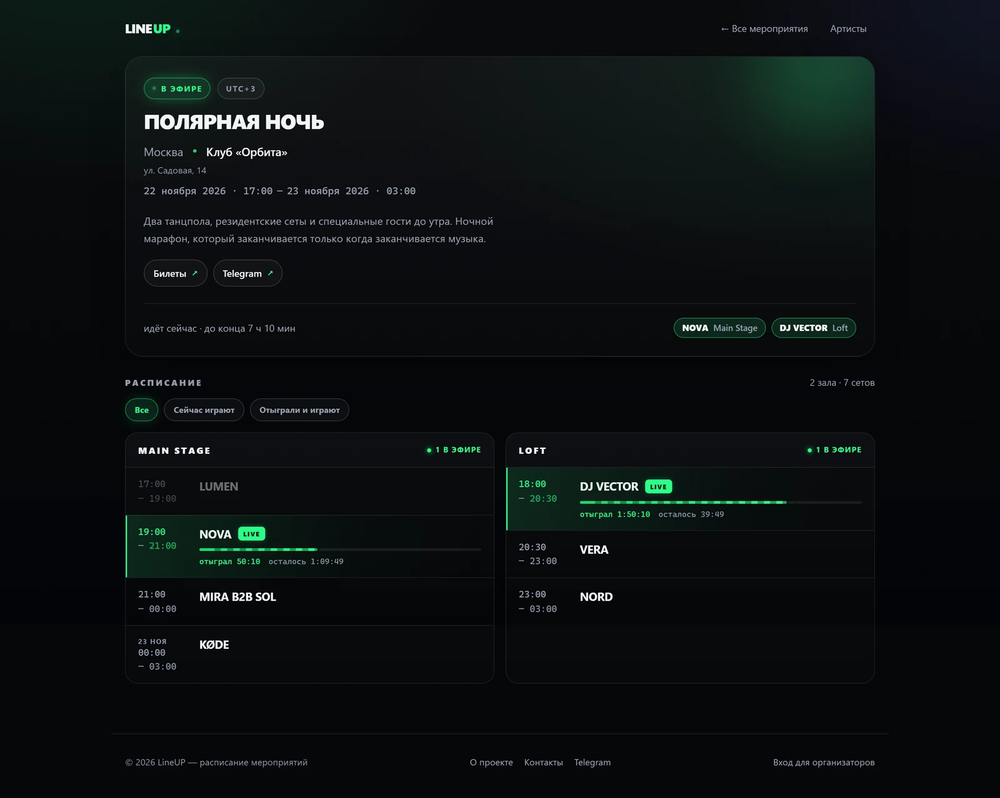
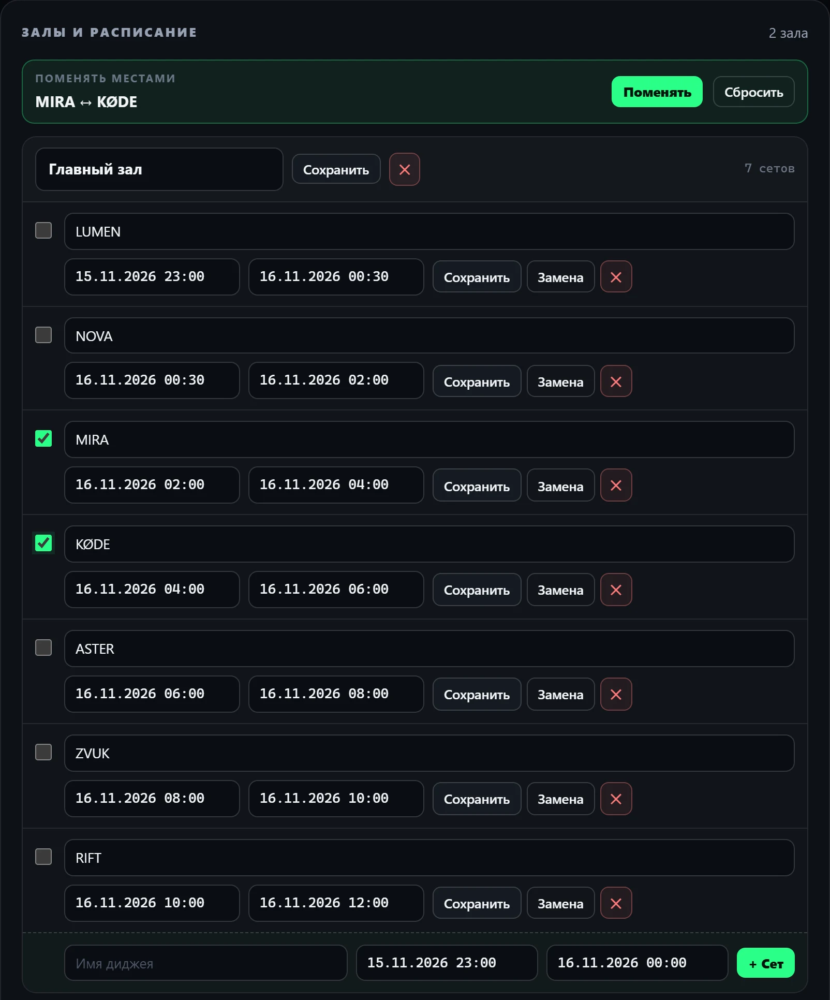

# LineUP

Сайт для проведения мероприятий: афиша, залы, расписание диджеев и живое
выделение того, кто играет прямо сейчас.

<p align="center">
  
</p>

- **Публичная часть** — адаптивная афиша: название, город и место, дата и время
  начала/конца (в том числе через полночь), залы и сеты. Текущий исполнитель
  подсвечивается зелёным, под ним идёт полоса прогресса и тикает
  «отыграл 00:42:15».
- **Фильтр расписания** — над залами есть кнопки «Все», «Сейчас играют» и
  «Отыграли и играют». Фильтр сам обновляется по ходу вечера: можно оставить на
  экране только текущие сеты или всех, кто уже отыграл и играет сейчас.
  Организатор может жёстко зафиксировать один из режимов в админке — тогда кнопки
  скрыты, и зритель видит только выбранные сеты.
- **Админка** (`/admin`) — вход по логину и паролю, создание и удаление
  мероприятий, залов и выступлений. У каждого сета обязательны начало и конец;
  пересечения внутри зала и выход за рамки мероприятия отклоняются.
- **Обмен артистов и замена** — галочки рядом с именами выбирают два сета: кнопка
  «Поменять» сразу меняет артистов местами, не трогая забронированное время.
  Кнопка «Замена» отмечает слот, где артист не приехал: на сайте выводится
  «Замена», а имя не попадает в список артистов и автозаполнение, пока сет не
  вернут обратно.
- **Роли промо-групп** — обычный администратор видит и меняет только свои
  мероприятия, главный (`super`) видит все и ведёт журнал действий. Лайнап можно
  опубликовать позже: как анонс без залов и артистов или с автопубликацией.
- **Архив мероприятий** — через 7 дней после окончания событие исчезает с
  публичного сайта, но остаётся в админке. Если перенести его время в будущее,
  оно снова публикуется автоматически; ненужное можно удалить.
- **Артисты и диджеи** — отдельная страница `/artists` с поиском. Показываются
  только артисты, у которых есть ещё не закончившийся сет в предстоящем или
  идущем мероприятии, и места, где они играют. Прошедшие мероприятия и
  отыгравшие сеты в список не попадают; артиста без актуального сета нельзя
  найти по имени. Исполнители из скрытого лайнапа не раскрываются. Если жёсткий
  фильтр расписания скрывает время сета, артист и мероприятие всё равно
  показываются, а вместо времени выводится пометка «Точное время выступления не
  показано». Список обновляется автоматически.
- **База исполнителей** — имена, добавленные в сеты, запоминаются и предлагаются
  в автозаполнении. У обычного администратора — только свои артисты, у главного —
  все. Главный может удалять лишние имена: они перестают предлагаться и
  находиться в публичном поиске артистов.
- **Оформление сайта** — главный администратор может загрузить PNG-логотип вместо
  надписи LineUP и добавить в подвал кнопки с описаниями: «О проекте»,
  «Контакты» и т. п. Текст кнопок и описаний меняется в админке.
- **Без зависимостей от фреймворков**: Python 3.11+, WSGI, SQLite, обычный
  JavaScript. В продакшене — gunicorn за nginx.

Демо-данные можно включить командой `python manage.py seed-demo`: появятся два
мероприятия, одно из них идёт «прямо сейчас», чтобы сразу увидеть живое
выделение.

## Скриншоты

| Публичная часть | Админка |
| --- | --- |
|  |  |
|  |  |

<p align="center">
  
  &nbsp;&nbsp;
  
</p>

Больше изображений и подписи к ним — в [docs/screenshots](docs/screenshots/README.md).

---

## Быстрый старт

Нужен Python 3.11+ (проверено на 3.15).

```bash
python -m venv .venv
# Linux/macOS:
source .venv/bin/activate
# Windows (PowerShell):
# .venv\Scripts\Activate.ps1

pip install -r requirements.txt

python manage.py initdb
python manage.py createadmin          # спросит логин и пароль (мин. 10 символов)
python manage.py seed-demo            # необязательно: демо-афиша
python manage.py serve --port 8080
```

Первый созданный администратор автоматически становится **главным**
(`super`): только он может добавлять других администраторов, удалять их и
менять им пароль.

Откройте:

- сайт — <http://127.0.0.1:8080/>
- админка — <http://127.0.0.1:8080/admin>

`manage.py serve` — только для разработки (встроенный сервер Python). На
сервере используется gunicorn, см. раздел «Деплой на nginx».

Полезные команды:

```bash
python manage.py list                 # список мероприятий
python manage.py createadmin --username admin
python manage.py createadmin --username second --super   # сделать главным
python manage.py passwd --username admin
python manage.py seed-demo
python manage.py initdb
```

Пароль можно передать неинтерактивно через `LINEUP_ADMIN_PASSWORD` (удобно для
автоматизации), но не храните его в истории shell на боевом сервере.

---

## Как пользоваться админкой

1. Войдите на `/admin`.
2. **«+ Новое мероприятие»** — заполните название, город, место, адрес,
   часовой пояс, начало и конец. Конец может быть на следующий день.
   Снимите галочку «Опубликовано», чтобы подготовить событие скрытно.
   Дата и время вводятся в формате **ДД.ММ.ГГГГ ЧЧ:ММ** (24 часа), например
   `05.11.2027 20:00`.
3. Сохраните. После этого станут доступны залы.
4. **«+ Добавить зал»** — например, «Зал 1». Залов может быть сколько угодно.
5. В карточке зала заполните строку **«Имя диджея»**, начало и конец сета и
   нажмите **«+ Сет»**.
6. Время подставляется автоматически: начало = конец предыдущего сета, конец =
   +1 час. Значения можно менять.
7. Кнопка **«Открыть на сайте ↗»** ведёт на публичную страницу.
8. В блоке **«Ссылки»** можно добавить до 12 ссылок (название + адрес
   `http://` или `https://`): билеты, сообщество, плейлист. На публичной
   странице они показываются кнопками под описанием.
9. Кнопка **«Админы»** в шапке (только у главного) открывает управление
   администраторами: добавить нового, сменить ему пароль, удалить. Главного
   администратора удалить или сменить ему пароль из этого раздела нельзя —
   свой пароль он меняет кнопкой **«Пароль»**.
10. Блок **«Показывать лайнап на сайте»** и поле **«Открыть лайнап
    автоматически»** управляют видимостью расписания. Если снять галочку,
    зрители видят анонс с описанием и ссылками, но без залов и артистов. Если
    оставить галочку и указать дату, до этого момента лайнап скрыт, а затем
    открывается сам.
11. Поле **«Кого показывать в расписании»** задаёт жёсткий фильтр публичной
    страницы: все сеты, только те, кто играет сейчас, или отыгравшие и играющие
    сейчас. В двух последних режимах кнопки фильтра у зрителей скрыты — обойти
    выбранный показ нельзя.
12. Кнопка **«Журнал»** (только у главного) показывает, кто создавал, менял и
    удалял мероприятия, залы, артистов и администраторов. Кнопка
    **«Очистить журнал»** удаляет все записи без создания новой.
13. При вводе имени исполнителя автозаполнение подсказывает имена из базы.
    Имя сохраняется даже после удаления сета — оно останется в подсказках.
    Кнопка **«Артисты»** (только у главного) открывает список имён: по нему можно
    искать, а лишние — удалять; удалённые перестанут предлагаться и находиться в
    публичном поиске.
14. Если мероприятие закончилось больше 7 дней назад, в списке появится метка
    **«скрыто»**, а ссылка «Открыть на сайте» будет недоступна. Измените начало
    и конец на будущее время и сохраните — событие опубликуется снова.
15. Кнопка **«Сайт»** (только у главного) открывает оформление публичных страниц:
    загрузку PNG-логотипа вместо надписи LineUP и редактор кнопок в подвале.
    У кнопки есть название, описание и необязательная ссылка; по клику на сайте
    открывается диалог с описанием. Если убрать логотип, надпись LineUP
    возвращается.

Обмен артистов: поставьте галочки у двух сетов (в одном или разных залах одного
мероприятия) — над расписанием появится кнопка **«Поменять»**. Артисты поменяются
местами, а начало и конец каждого сета останутся прежними; изменения сохраняются
сразу. Если артист не приехал, нажмите **«Замена»** в его строке: на сайте в этом
слоте будет написано «Замена», а имя не попадёт в публичный список артистов и в
подсказки, пока вы не нажмёте **«Вернуть»**.

Обычный администратор видит и может менять только созданные им мероприятия.
Чужие мероприятия для него не существуют — API отвечает `404 not_found`, чтобы
не раскрывать их существование. Главный администратор видит все мероприятия и
журнал действий. При удалении администратора его мероприятия переходят
действующему главному.

Ограничения, которые проверяет сервер:

- конец мероприятия позже начала, длительность — не больше 14 дней;
- сет полностью лежит внутри времени мероприятия;
- в одном зале сеты не пересекаются (вернётся понятная ошибка с именем
  конфликтующего диджея);
- имя исполнителя, название зала и мероприятия обязательны.

Удаление мероприятия каскадно удаляет его залы и сеты.

Публичная видимость: `published = 1` и `ends_at >= now - 7 дней`. Черновики и
события, завершившиеся раньше, не отдаются публичным API и не открываются по
прямой ссылке `/e/<slug>`, но продолжают отображаться в админке. Срок можно
изменить переменной `LINEUP_PUBLIC_RETENTION_DAYS`.

Часовой пояс — IANA-имя (`Europe/Moscow`, `Asia/Yekaterinburg`, …). Вся
админка вводит и показывает время **в поясе мероприятия** в формате
`ДД.ММ.ГГГГ ЧЧ:ММ` (24 часа), а в базе хранится UTC, поэтому зритель в другом
часовом поясе увидит корректное время. API по-прежнему принимает и отдаёт
локальные строки `YYYY-MM-DDTHH:MM`.

---

## Как работает «сейчас играет»

- Все моменты времени хранятся в UTC.
- Публичная страница получает вместе с расписанием `serverNow` и поправляет
  расхождение часов устройства.
- Раз в секунду клиент пересчитывает состояние каждого сета:
  `прошёл` / `идёт` / `впереди`.
- Для идущего сета включается класс `.is-live`: зелёный фон и полоса слева,
  бейдж **LIVE**, полоса прогресса с бегущими штрихами и подписи
  «отыграл Ч:ММ:СС» и «осталось Ч:ММ:СС».
- Список в шапке и счётчики «N в эфире» в залах обновляются от тех же данных.
- Страница тихо перезапрашивает расписание раз в 30 секунд, поэтому изменения
  из админки появляются без перезагрузки.
- Если сейчас между сетами, показывается «Антракт», до начала — обратный
  отсчёт, после конца — «мероприятие прошло».

---

## Структура проекта

```
app.py                  WSGI-приложение, маршруты, API, защита
db.py                   SQLite: схема, подключение
security.py             scrypt-пароли, токены сессий
timeutil.py             пересчёт часовых поясов, валидация времени
manage.py               CLI: initdb, createadmin, passwd, seed-demo, serve
tests/test_app.py       интеграционные тесты (48 шт.)
requirements.txt
public/
  index.html            главная: текущее/ближайшее событие + афиша
  event.html            страница мероприятия /e/<slug>
  artists.html          публичный список артистов и диджеев /artists
  admin.html            админка
  assets/style.css      оформление
  assets/common.js      форматирование, расписание, «часы»
  assets/home.js        главная
  assets/event.js       страница события
  assets/artists.js     поиск и список артистов
  assets/admin.js       админка
deploy/
  nginx.conf            пример конфигурации nginx
  lineup.service        unit systemd для gunicorn
  lineup.env.example    переменные окружения
data/                   SQLite-база (создаётся автоматически, в git не входит)
```

---

## Настройки окружения

| Переменная | По умолчанию | Назначение |
|---|---|---|
| `LINEUP_DB` | `data/lineup.db` | путь к SQLite-базе |
| `LINEUP_TRUST_PROXY` | `1` | доверять `X-Forwarded-*` от nginx |
| `LINEUP_COOKIE_SECURE` | `auto` | `1` — ставить cookie только по HTTPS; `auto` — по схеме запроса |
| `LINEUP_SESSION_HOURS` | `12` | срок жизни сессии админки |
| `LINEUP_LOGIN_MAX_FAILURES` | `10` | неудачных входов с одного IP до блокировки |
| `LINEUP_LOGIN_MAX_USER_FAILURES` | `20` | неудачных входов на один логин |
| `LINEUP_LOGIN_WINDOW` | `900` | окно блокировки, секунд |
| `LINEUP_ASSET_CACHE` | `public, max-age=86400` | `Cache-Control` для статики, когда её отдаёт приложение |
| `LINEUP_PUBLIC_RETENTION_DAYS` | `7` | сколько дней после окончания событие остаётся на сайте |
| `LINEUP_AUTO_INIT` | `1` | создавать схему БД при старте |
| `LINEUP_PUBLIC_DIR` | `./public` | каталог статики |

Секретов в окружении нет: пароли хранятся в виде scrypt-хешей, сессии — это
случайные токены, в базе лежат только их SHA-256.

---

## Деплой на nginx (Ubuntu/Debian, один сервер)

Ниже — вариант «nginx + gunicorn + SQLite». Всё уже подготовлено в `deploy/`.

### 1. Пользователь и каталоги

```bash
sudo useradd --system --home /var/lib/lineup --shell /usr/sbin/nologin lineup
sudo mkdir -p /var/lib/lineup /etc/lineup /var/www
sudo chown lineup:lineup /var/lib/lineup
sudo chmod 750 /var/lib/lineup
```

### 2. Код и зависимости

Скопируйте проект в `/var/www/lineup` (git, rsync, scp — любым способом):

```bash
cd /var/www/lineup
python3 -m venv .venv
.venv/bin/pip install -r requirements.txt

sudo chown -R root:lineup /var/www/lineup
sudo chmod -R g+rX /var/www/lineup
# каталог public должен читаться nginx:
sudo chmod -R a+rX /var/www/lineup/public
```

### 3. База и администратор

```bash
cd /var/www/lineup
sudo -u lineup env LINEUP_DB=/var/lib/lineup/lineup.db \
    .venv/bin/python manage.py initdb
sudo -u lineup env LINEUP_DB=/var/lib/lineup/lineup.db \
    .venv/bin/python manage.py createadmin
# при желании — демо-данные:
sudo -u lineup env LINEUP_DB=/var/lib/lineup/lineup.db \
    .venv/bin/python manage.py seed-demo
```

### 4. Окружение и systemd

```bash
sudo cp deploy/lineup.env.example /etc/lineup/lineup.env
sudo nano /etc/lineup/lineup.env          # проверьте пути
sudo chown root:lineup /etc/lineup/lineup.env
sudo chmod 640 /etc/lineup/lineup.env

sudo cp deploy/lineup.service /etc/systemd/system/lineup.service
sudo systemctl daemon-reload
sudo systemctl enable --now lineup
sudo systemctl status lineup
```

Проверка без nginx:

```bash
curl http://127.0.0.1:8000/healthz
# {"status":"ok"}
```

### 5. nginx

```bash
sudo cp deploy/nginx.conf /etc/nginx/sites-available/lineup
sudo nano /etc/nginx/sites-available/lineup   # домен, пути, сертификаты
sudo ln -s /etc/nginx/sites-available/lineup /etc/nginx/sites-enabled/lineup
sudo nginx -t
sudo systemctl reload nginx
```

Для HTTPS проще всего выпустить сертификат Let's Encrypt («certbot --nginx»)
или вписать пути к существующему сертификату. После включения HTTPS
обязательно оставьте `LINEUP_COOKIE_SECURE=1` в `/etc/lineup/lineup.env` —
cookie админки не будут уходить по HTTP.

### 6. Обновление

```bash
cd /var/www/lineup
# обновите файлы (git pull / rsync)
.venv/bin/pip install -r requirements.txt
sudo systemctl restart lineup
```

Схема БД обновляется автоматически при старте (все `CREATE ... IF NOT EXISTS`).
Перед крупным обновлением сделайте бэкап базы.

### 7. Бэкапы

```bash
# корректный бэкап SQLite на работающей базе:
sudo -u lineup sqlite3 /var/lib/lineup/lineup.db \
  ".backup '/var/backups/lineup-$(date +%F).db'"
```

Достаточно ежедневного cron-задания и хранения копий вне сервера.

---

## Безопасность

- Пароли — `scrypt` (N=16384, r=8, p=1) со случайной солью; сравнение
  постоянным по времени.
- Сессии — случайный 256-битный токен; в БД хранится только его SHA-256.
  Cookie: `HttpOnly`, `SameSite=Strict`, `Secure` в HTTPS, срок 12 часов.
- CSRF: для всех изменяющих запросов обязателен заголовок `X-CSRF-Token`,
  привязанный к сессии, плюс проверка `Origin`.
- Ограничение перебора: по IP и по логину; при превышении — HTTP 429.
- Одинаковый ответ на неверный логин и несуществующего пользователя,
  scrypt-заглушка против утечки по времени.
- CSP без `unsafe-inline`, `X-Frame-Options: DENY`, `nosniff`,
  `Referrer-Policy`, HSTS при HTTPS.
- Пользовательские строки выводятся только через `textContent` — HTML из
  названий и имён не исполняется.
- Установка без пароля по умолчанию: администратор создаётся только вручную
  через `manage.py createadmin`.

Что стоит сделать дополнительно на боевом сервере:

- закрыть `/admin` по IP в nginx, если админкой пользуются с одного адреса;
- включить `fail2ban` на 429/401 в логах gunicorn;
- регулярно обновлять систему и Python-зависимости;
- не запускать несколько серверов на одной SQLite-базе (см. ограничения).

Пример ограничения админки по IP (добавить в `server`-блок nginx):

```nginx
location /admin {
    allow 203.0.113.10;
    deny all;
    proxy_pass http://lineup_app;
    include proxy_params;   # или повторите proxy_set_header из конфига
}
```

---

## Тесты

```bash
python -m unittest discover -s tests -v
```

Покрыто: публичная выдача, скрытие черновиков, скрытого лайнапа и событий
старше 7 дней, жёсткий фильтр расписания в том числе в разделе артистов, вход и
cookie-флаги, CSRF, чужой Origin, rate limit, смена
пароля с отзывом сессий, CRUD мероприятий, залов и сетов, проверка пересечений
и границ времени, каскадное удаление, разграничение мероприятий и базы
исполнителей по владельцам, публичный поиск артистов, удаление артистов из
подсказок, журнал действий и его очистка, заголовки безопасности, 404/405.

---

## API (кратко)

Публичное:

- `GET /api/public/featured` — текущее/ближайшее событие, остальные в `others`.
- `GET /api/public/events` — список опубликованных актуальных событий.
- `GET /api/public/events/<slug>` — событие с залами и сетами.
- `GET /api/public/artists` — артисты с ещё не закончившимися сетами в
  предстоящих или идущих мероприятиях. Прошедшие мероприятия и отыгравшие сеты
  не отдаются. Скрытые настройкой `lineupFilter` сеты не отдаются, но
  мероприятие и артист остаются в выдаче: время выступления появляется вместе с
  сетом в публичном расписании. Сеты, отмеченные заменой, в список артистов не
  попадают.
- `GET /api/public/artists?q=<имя>` — поиск только по артистам, у которых есть
  актуальный сет. Имена без предстоящих выступлений и удалённые из базы не
  находятся.
- `GET /api/public/site` — оформление публичных страниц: `logoUrl` (или `null`)
  и массив `links` с полями `{id, label, description, url}`.
- `GET /logo` — PNG-логотип из базы; `404`, если логотип не загружен.

Админка (нужна сессия; изменения — с `X-CSRF-Token`):

```
POST   /api/admin/login              {username, password}
POST   /api/admin/logout
GET    /api/admin/session
POST   /api/admin/password           {currentPassword, newPassword}

GET    /api/admin/events
POST   /api/admin/events
GET    /api/admin/events/<id>
PATCH  /api/admin/events/<id>
DELETE /api/admin/events/<id>

POST   /api/admin/events/<id>/halls
PATCH  /api/admin/halls/<id>
DELETE /api/admin/halls/<id>

POST   /api/admin/halls/<id>/performances
PATCH  /api/admin/performances/<id>
POST   /api/admin/performances/swap   {firstId, secondId}
DELETE /api/admin/performances/<id>

GET    /api/admin/performers         # автозаполнение имён (свои; у super — все)
DELETE /api/admin/performers?name=…  # убрать имя из подсказок, только главный

GET    /api/admin/audit              # журнал действий, только главный
DELETE /api/admin/audit              # очистить журнал, только главный

GET    /api/admin/users              # только главный администратор
POST   /api/admin/users              {username, password}
PATCH  /api/admin/users/<id>         {password}  # только не-главный
DELETE /api/admin/users/<id>         # только не-главный

GET    /api/admin/site               # логотип и кнопки, только главный
PUT    /api/admin/site/links         {links: [{label, description, url}]}
PUT    /api/admin/site/logo          {data: "<base64 PNG>"}
DELETE /api/admin/site/logo          # вернуть надпись LineUP
```

Кнопки подвала: до 8 штук, название до 60 символов, описание до 1200,
ссылка — необязательная и только `http://`/`https://`. У кнопки должно быть
описание или ссылка. Логотип принимается только в PNG (сигнатура и размеры
проверяются), до 180 КБ; он хранится в `site_settings` и отдаётся маршрутом
`/logo`. Публичные страницы получают `logoUrl` и кнопки из
`GET /api/public/site`.

Поле `links` в запросах события — массив `{title, url}` (до 12 штук, только
`http://`/`https://`). Если поле не передано при `PATCH`, ссылки не меняются;
пустой массив удаляет все ссылки.

Видимость лайнапа задаётся полями `lineupVisible` (bool, по умолчанию `true`) и
`lineupPublishAt` (локальная строка `YYYY-MM-DDTHH:MM` в поясе мероприятия или
`null`). Расписание видно публично, только если `lineupVisible` включён и время
`lineupPublishAt` уже наступило. Пока лайнап скрыт, публичный API отдаёт
`lineupVisible: false`, `halls: []` и нулевые счётчики в списке; описание и
ссылки остаются.

Поле `lineupFilter` (`all`, `live` или `played`, по умолчанию `all`) задаёт
жёсткий фильтр публичного расписания. `all` оставляет зрителям кнопки фильтра,
`live` показывает только текущие сеты, `played` — отыгравшие и текущие. В
режимах `live` и `played` публичная страница скрывает кнопки и применяет
выбранный режим автоматически; неверное значение отклоняется с ошибкой 400.

`PATCH /api/admin/performances/<id>` принимает `performer`, `startsAt`, `endsAt`
и `isReplacement` (bool). С `isReplacement: true` имя артиста сохраняется в базе,
но публично в слоте и в ответах API выводится `displayPerformer: "Замена"`, а
имя убирается из автозаполнения и публичного списка, если им не подписан ни один
другой сет. `POST /api/admin/performances/swap` с `{firstId, secondId}` меняет
артистов и признаки замены двух сетов одного мероприятия, не меняя их время.

В админских ответах у мероприятия также есть `ownerId`, `ownerUsername`,
`lineupVisible`, `lineupPublishAt` (UTC), `lineupPublishAtLocal` и
`publiclyVisible` — последнее равно `false` у черновиков и событий старше срока
публикации. Обычный администратор получает только свои мероприятия; обращение к
чужому отвечает `404 not_found`. Журнал `GET /api/admin/audit` доступен только
главному и возвращает записи `{actor, action, detail, createdAt, ...}` от новых
к старым (параметры `limit` до 500 и `before` для постраничной загрузки).
`DELETE /api/admin/audit` очищает журнал целиком и сам в него не пишется.

Имена исполнителей хранятся в таблице `performers` с привязкой к владельцу
мероприятия. Они попадают туда при добавлении и изменении сета и не удаляются
вместе с выступлением, поэтому автозаполнение работает как архив имён. Главный
администратор может убрать имя из архива через
`DELETE /api/admin/performers?name=<имя>`; уже добавленные сеты не меняются, но
артист перестаёт находиться через публичный поиск.

Время в админских запросах передаётся локальной строкой
`YYYY-MM-DDTHH:MM` в часовом поясе мероприятия; в ответах есть и UTC
(`startsAt`), и локальное (`startsAtLocal`).

---

## Ограничения

- SQLite рассчитан на один сервер и умеренную нагрузку (афиша читается
  значительно чаще, чем пишется). Для нескольких серверов понадобится
  PostgreSQL — слой доступа к данным изолирован в `db.py`/`app.py`.
- Нет загрузки изображений и email-восстановления пароля: сброс — командой
  `manage.py passwd` на сервере или главным администратором в разделе
  «Админы».
- Список часовых поясов в селекте фиксирован в `app.py` (`TIMEZONES`);
  любые IANA-зоны поддерживаются API, список легко расширить.
